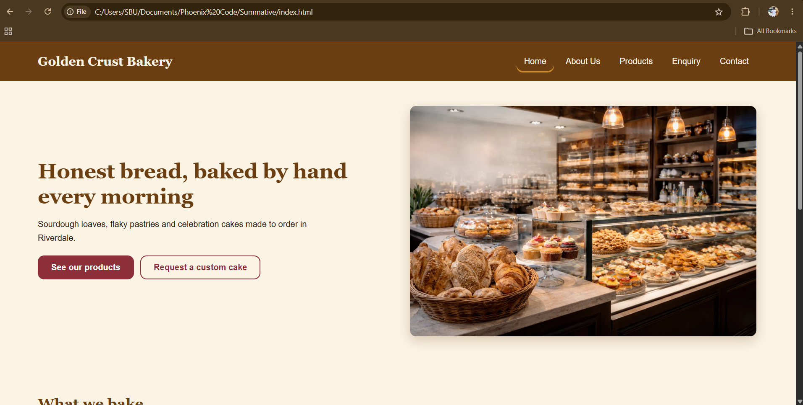
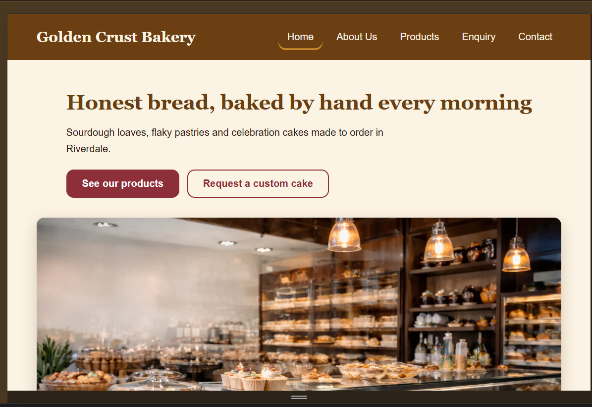
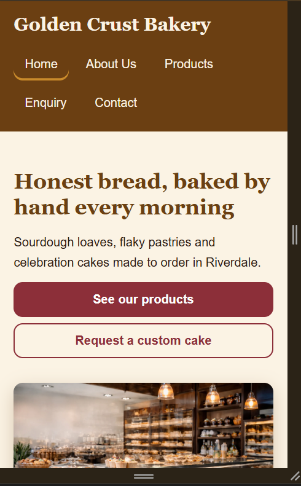
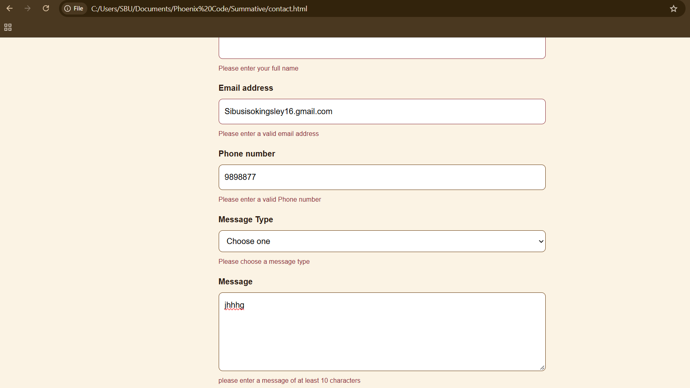
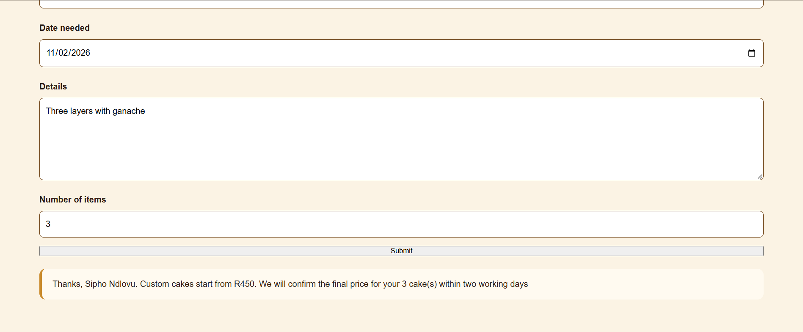
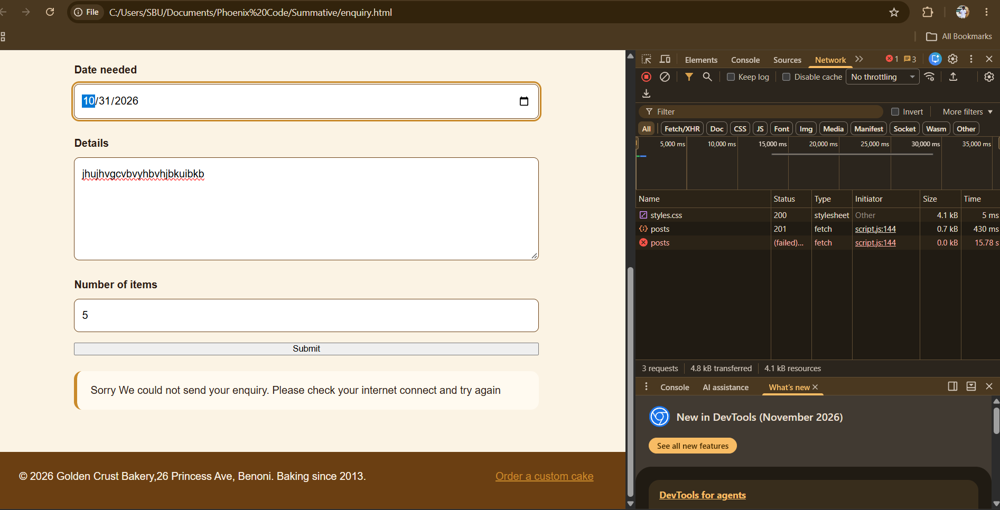
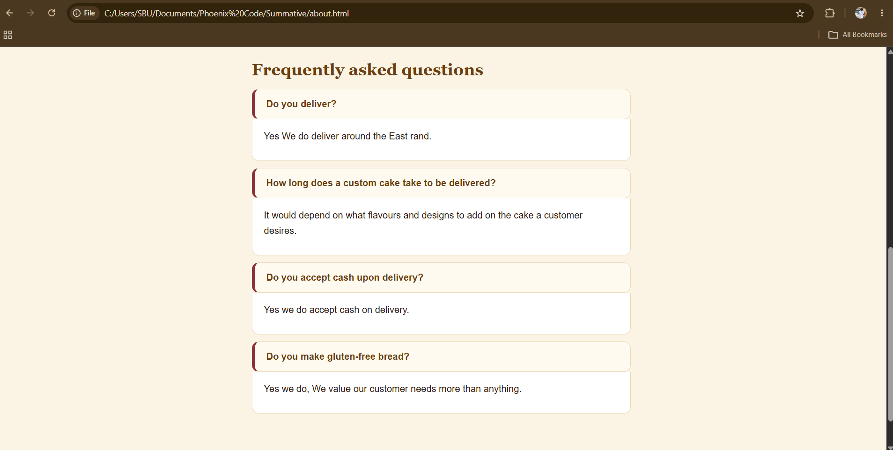
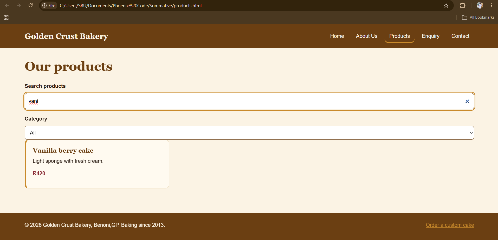
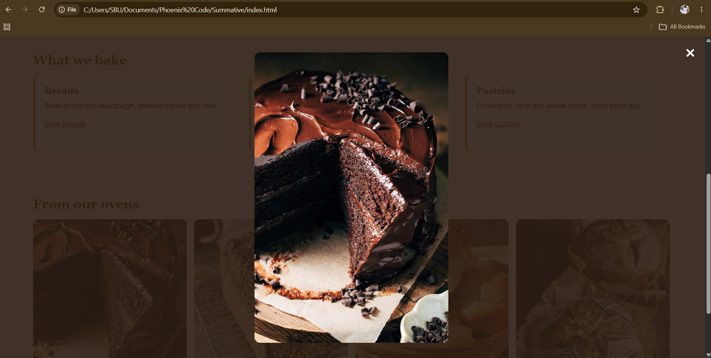
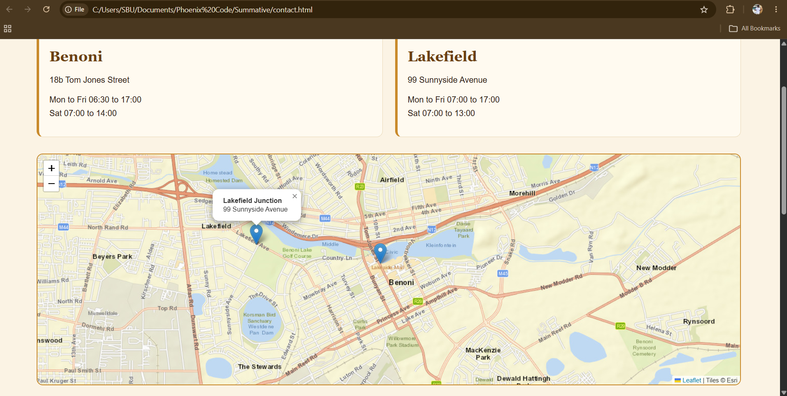

# Golden Crust Bakery Website

## Student Information
- **Name:** Sibusiso Khoza
- **Student Number:** ST10532951
- **Module:** Web Development (WEDE5020)
- **Institution:** Rosebank International
- **Assessment:** Portfolio of Evidence – Part 1 (planning), Part 2 (CSS and responsive design), Part 3 (JavaScript and SEO)
- **Live site:** [add your Netlify or GitHub Pages link]
- **Repository:** [add your GitHub link]

## Project Overview
This repository contains the website project for **Golden Crust Bakery**, a
family-owned small business in Benoni selected as the target organisation for this
Portfolio of Evidence (approved from the two proposals submitted, see
`Website_Project_Proposal.docx`). The site is a five-page HTML/CSS/JavaScript
website showcasing the bakery's story, products, and contact details.

## Website Goals and Objectives
- Increase local brand visibility and online presence.
- Generate enquiries for custom and bulk cake orders.
- Provide customers with up-to-date product and location information.
- **KPIs:** monthly enquiry form submissions, time spent on the Products page,
  click-through rate from the homepage to the Products page.

## Key Features and Functionality
- Homepage with hero banner, introduction, call to action and an image gallery with lightbox.
- About Us page with history, mission, vision, team and an FAQ accordion.
- Products page loaded dynamically from JavaScript, with search and category filter.
- Enquiry page with a validated form, a response by order type, and AJAX submission.
- Contact page with two branch locations, an interactive Leaflet map, and a validated message form that builds an email.
- Consistent navigation across all five pages.

## Sitemap


```
Homepage (index.html)
├── About Us (about.html)
├── Products (products.html)
├── Enquiry (enquiry.html)
└── Contact (contact.html)
```

## File and Folder Structure
```
golden-crust-bakery/
├── index.html
├── about.html
├── products.html
├── enquiry.html
├── contact.html
├── robots.txt
├── sitemap.xml
├── css/
│   └── styles.css
├── js/
│   └── script.js
├── images/
├── content-research/
│   ├── home/
│   ├── about/
│   ├── products/
│   ├── enquiry/
│   └── contact/
├── assets/
│   └── sitemap.png
├── screenshots/
└── README.md
```

## Timeline and Milestones
| Milestone | Target Week |
|---|---|
| Planning, research and content gathering | Week 1–2 |
| HTML structure and page linking (Part 1) | Week 3–4 |
| CSS styling and responsive design (Part 2) | Week 5–6 |
| JavaScript functionality, SEO and testing (Part 3) | Week 7–8 |

## Part 1 Details
Part 1 covered project initiation and planning: organisation selection, the
Website Project Proposal, content research and sourcing, the sitemap, file
and folder structure, and the initial set of HTML pages with working navigation.

## Part 2 Details (CSS styling and responsive design)
- Palette: cream `#fbf3e4`, golden brown `#c98a2b`, dark brown `#6b3f12`, burgundy `#8c2f39` (from the Part 1 proposal).
- Fonts: Fraunces (serif headings) and Work Sans (body), loaded from Google Fonts.
- Layout: Flexbox for header, nav and hero; CSS Grid for card sections.
- Breakpoints: desktop above 64em, tablet 40em to 64em (2 columns), mobile below 40em (1 column).
- Units: `rem`/`em` for type and spacing, `%` and `fr` for widths.
- Interaction: `:hover`, `:focus-visible` and `:active` on links, buttons, cards and form fields.

## Part 3 Details (JavaScript, forms and SEO)
- **Contact form:** validation of name, email, South African phone number, message type and message length, with error messages under each field. Valid input is compiled into an email with a `mailto:` link to the recipient set in the code.
- **Enquiry form:** the same validation plus date (not in the past) and quantity checks. Valid input shows a response based on the order type. The data is sent with AJAX (`fetch`, POST) to a test endpoint (JSONPlaceholder) without reloading the page, with sending, success and failure messages.
- **Accordion:** FAQ on the About page, with `aria-expanded` updated on each click.
- **Dynamic content and search:** products stored in a JavaScript array, rendered as cards, with live search and category filter and a no-results message.
- **Gallery with lightbox:** closes with the close button, a click outside the image, or Escape.
- **Interactive map:** Leaflet map with a marker and popup for each branch.
- **Animation:** CSS transitions plus a scroll reveal using `IntersectionObserver`; reduced motion is respected.

### SEO
**Keyword research** (method: Google search suggestions and "People also ask" for local bakery searches)

| Page | Target keywords | Where used |
|------|----------------|------------|
| Home | bakery Benoni | title, description, h1, intro |
| About | Family-owned bakery | title, description, h2 |
| Products | Custom cake Benoni | title, description, h1, product text |
| Enquiry | order Benoni | title, description, h1 |
| Contact | bakery opening hours Benoni | title, description, h1 |

- **On-page:** unique title and meta description per page, one `h1` per page with `h2`/`h3` below, descriptive lowercase image names with alt text, short clean file names, internal links, viewport tag for mobile.
- **Extra files:** `robots.txt` allows crawling and points to `sitemap.xml`, which lists all five pages.
- **Page speed:** compressed images, `loading="lazy"` below the fold, scripts at the bottom, one stylesheet.
- **Security:** HTTPS from the host; form input validated on the client (a production site would also validate on the server).
- **Off-page plan:** [To promote the website, Golden Crust Bakery would list itself on Google Business Profile and a Benoni community Facebook group so that other websites link back to us. We would also post photos of our sourdough and celebration cakes on Facebook and Instagram with a link to the website’s Products page. We would measure success by counting the number of enquiry form submissions each month.]

## Changelog
| Date | File | Change | Reason |
|---|---|---|---|
| 21 August 2026 | folders | Initial repository setup: file/folder structure created | Part 1 |
| 21 August 2026 | all pages | Added index.html, about.html, products.html, enquiry.html, contact.html with working navigation | Part 1 |
| 21 August 2026 | css/styles.css | Added base css/styles.css | Part 1 |
| 2026-0 | assets, README | Added sitemap diagram and README.md documentation | Part 1 |
| 2026-15-22 | [files] | **Add each Part 1 feedback correction here, one row per change, with the lecturer's comment** | Feedback from Part 1 |
| 2026-08-25 | css/styles.css | Created CSS reset and base styles (font, colours, margin/padding) | Part 2 |
| 2026-08-25 | css/styles.css | Added typography styles (font-family, size, weight, line-height, letter-spacing) | Part 2 |
| 2026-08-25 | css/styles.css | Built Flexbox header/hero and Grid card layout | Part 2 |
| 2026-08-28 | css/styles.css | Added colours, borders, box-shadows and hover/focus/active states | Part 2 |
| 2026-08-28 | css/styles.css | Added tablet and mobile media queries and relative units | Part 2 |
| 2026-08-28 | index.html | Added responsive hero image | Part 2 |
| 2026-08-28 | [files] | **Add each Part 2 feedback correction here, one row per change, with the lecturer's comment** | Feedback from Part 2 |
| 2026-08-29 | js/script.js, all pages | Created `js/script.js` and linked it at the bottom of every page | Part 3 |
| 2026-08-30 | contact.html, js/script.js | Added contact form with validation and `mailto:` email | Part 3 |
| 2026-09-30 | enquiry.html, js/script.js | Added enquiry form with validation and response message by order type | Part 3 |
| 2026-09-03 | js/script.js | Added AJAX submission with `fetch` | Part 3 |
| 2026-09-03 | about.html, css/styles.css, js/script.js | Added FAQ accordion | Part 3 |
| 2026-09-04 | products.html, js/script.js | Products rendered from an array, with search and category filter | Part 3 |
| 2026-09-04 | index.html, css/styles.css, js/script.js | Added image gallery with lightbox | Part 3 |
| 2026-09-04 | contact.html, css/styles.css, js/script.js | Replaced Google Maps iframe with Leaflet map and branch markers. Tiles changed to Esri because OpenStreetMap blocked local file requests and CARTO required an API key | Part 3 |
| 2026-09-06 | css/styles.css, js/script.js | Added scroll reveal animation with reduced-motion support | Part 3 |
| 2026-09-06 | all pages | Added unique title and meta description, one h1 per page, internal links, alt text | Part 3 |
| 2026-09-06 | robots.txt, sitemap.xml | Created both files | Part 3 |
| 2026-09-06 | folders and files | Renamed folders and files to lowercase for case-sensitive hosting | Part 3 |


Part 3: `screenshots/contact-errors.png`, `screenshots/enquiry-response.png`, `screenshots/network-fetch.png`, `screenshots/accordion.png`, `screenshots/search.png`, `screenshots/lightbox.png`, `screenshots/map.png`











 
## Deployment
Deployed on [Netlify or GitHub Pages]. [Two or three lines on how you deployed.]

## References
- Google Fonts (2026) *Google Fonts*. Available at: https://fonts.google.com (Accessed: 20 August 2026).
- MDN Web Docs (2026) *HTML: HyperText Markup Language*. Mozilla. Available at: https://developer.mozilla.org/en-US/docs/Web/HTML (Accessed: 2026-08-20).
- MDN Web Docs (2026) *CSS: Cascading Style Sheets*. Mozilla. Available at: https://developer.mozilla.org/en-US/docs/Web/CSS (Accessed: 2026-08-20).
- MDN Web Docs (2026) *JavaScript*. Mozilla. Available at: https://developer.mozilla.org/en-US/docs/Web/JavaScript (Accessed: 2026-08-20).
- MDN Web Docs (2026) *Responsive images*. Mozilla. Available at: https://developer.mozilla.org/en-US/docs/Learn_web_development/Core/Structuring_content/HTML_images (Accessed: 2026-08-20).
- MDN Web Docs (2026) *Using media queries*. Mozilla. Available at: https://developer.mozilla.org/en-US/docs/Web/CSS/CSS_media_queries/Using_media_queries (Accessed: 2026-08-20).
- MDN Web Docs (2026) *Using the Fetch API*. Mozilla. Available at: https://developer.mozilla.org/en-US/docs/Web/API/Fetch_API/Using_Fetch (Accessed: 2026-10-18).
- MDN Web Docs (2026) *Intersection Observer API*. Mozilla. Available at: https://developer.mozilla.org/en-US/docs/Web/API/Intersection_Observer_API (Accessed: 2026-10-19).
- Leaflet (2026) *Leaflet: an open-source JavaScript library for interactive maps*. Available at: https://leafletjs.com (Accessed: 2026-10-19).
- Esri (2026) *World Street Map*. Available at: https://www.arcgis.com (Accessed: 2026-10-19).
- JSONPlaceholder (2026) *Free fake API for testing and prototyping*. Available at: https://jsonplaceholder.typicode.com (Accessed: 2026-10-22).
- Squoosh (2026) *Image compression*. Available at: https://squoosh.app (Accessed: 2026-10-25).
- Unsplash (2026) *Free images*. Available at: https://unsplash.com (Accessed: 2026-08-20).
- Pexels (2026) *Free stock photos*. Available at: https://www.pexels.com (Accessed: 2026-08-20).
- W3Schools (2026) *HTML Forms*. Available at: https://www.w3schools.com/html/html_forms.asp (Accessed: 2026-08-20).
- Domains.co.za (2026) *.co.za domain registration pricing*. Available at: https://www.domains.co.za (Accessed: 2026-08-20
- Afrihost (2026) *Shared web hosting plans*. Available at: https://www.afrihost.com/web-hosting (Accessed: 2026-08-20).
